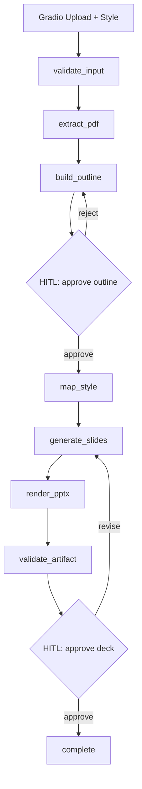

# PDF2Deck Agent

A production-oriented MVP that converts a PDF chapter into a structured, styled PowerPoint deck.

## Architecture



The LLM is responsible for semantic transformation; deterministic Python code owns PDF extraction, validation, style mapping, and PowerPoint rendering.

## Quick start

Requires [uv](https://docs.astral.sh/uv/getting-started/installation/) and Python 3.11–3.13 (uv downloads a matching interpreter if none is installed).

```bash
uv sync --extra dev
cp .env.example .env
# add OPENAI_API_KEY
uv run pdf2deck
```

`uv sync` creates `.venv`, installs the project in editable mode with the `dev` extra, and writes `uv.lock`. `uv run` executes inside that environment, so there is no need to activate it.

Open the Gradio URL printed by the app.

Development commands:

```bash
uv run pytest
uv run ruff check .
uv run mypy src
```

## Personalization

The look of the deck comes from a JSON preferences file. Every field is optional and falls back to the default shown here; an unknown field is rejected.

```json
{
  "name": "technical-minimal",
  "tone": "educational",
  "density": "balanced",
  "include_speaker_notes": true,
  "slide_size": { "width_in": 13.333, "height_in": 7.5 },
  "colors": {
    "main": "#1F4E79",
    "highlight": "#70AD47",
    "text": "#000000",
    "background": "#FFFFFF"
  },
  "fonts": { "heading": "Aptos", "body": "Aptos" },
  "type_scale": { "title_pt": 32, "body_pt": 18 }
}
```

`tone` is one of `formal`, `educational`, `executive`, `conversational`; `density` is one of `sparse`, `balanced`, `dense`. Both are passed to the model. The other fields are applied by the renderer: `main` colours titles, `highlight` the rule under them, `text` the body.

- Upload the file in the UI as the preferences file. It then sets the whole style, and the Style name, Tone, Density and Font fields are ignored.
- Without a file, those four fields set the style and the rest uses the defaults.
- `DEFAULT_PREFERENCES_PATH` names a file to use whenever none is uploaded.

### Starting from a PowerPoint template

Open **Create a preferences file from a PPTX template** in the UI, upload a `.pptx` and press **Extract preferences**. This reads the template's slide size, theme colours, theme fonts, text sizes and text density into a preferences file. Review or edit it, then upload it as the preferences file.

The template itself is not used to build the deck, so its backgrounds, artwork and layouts do not carry over.

## Production direction

- Replace `MemorySaver` with PostgreSQL-backed LangGraph persistence.
- Put generated artifacts in object storage (S3-compatible).
- Run the graph behind a queue/worker service.
- Keep Gradio as an internal/operator UI; expose an API for production clients.
- Add a render-validation service using LibreOffice/headless PowerPoint-compatible rendering for visual regression.
- Use Langfuse datasets/evaluations for content-preservation regression tests.
